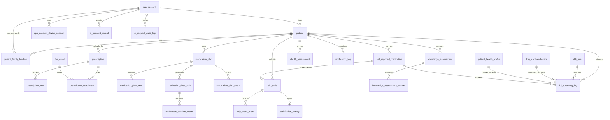

# BACKEND_STRUCTURE.md

## 1. Document purpose

This document is the authoritative backend structure specification for `backend-v2`.

Rules:

1. `Standard document/BACKEND_STRUCTURE.md` is the only source of truth for future backend design and implementation.
2. The frozen `backend/` codebase can be inspected for legacy behavior, but it does not define future `backend-v2` contracts.
3. If a legacy contract, schema, or flow conflicts with this document, this document wins for `backend-v2`.
4. This document defines structure and contracts. It does not replace SQL migration scripts, but all future SQL must be generated from this document.

## 2. Backend positioning

### 2.1 Service identity

- Service name: `backend-v2`
- Runtime baseline: Java 17 + Spring Boot 3.2+
- API response envelope: `CommonResult<T>`
- Patient and family API prefix: `/app-api/**`
- Pharmacist and doctor API prefix: `/admin-api/**`

### 2.2 Compatibility rule

- `backend/` remains the frozen legacy system.
- `backend-v2` is a clean new service and must not inherit legacy starter design.
- Professional user identity is compatible with legacy backend user tables:
  - user table: `system_users`
  - role table: `system_role`
  - user-role relation: `system_user_role`
  - legacy auth entry: `/system/auth/*`
- App-side patient and family identity is a new independent account system inside `backend-v2`.

### 2.3 Unified conventions

#### Response shape

```json
{
  "code": 200,
  "msg": "OK",
  "data": {}
}
```

#### Standard audit columns

Unless explicitly marked otherwise, all business tables in `backend-v2` include these common columns:

| Column | Type | Nullable | Rule |
|---|---|---|---|
| `id` | `BIGINT` | No | Primary key |
| `creator` | `VARCHAR(64)` | Yes | Creator identifier |
| `create_time` | `DATETIME` | No | Creation time |
| `updater` | `VARCHAR(64)` | Yes | Last updater identifier |
| `update_time` | `DATETIME` | No | Last update time |
| `deleted` | `BIT(1)` | No | Logical delete flag, default `0` |
| `tenant_id` | `BIGINT` | No | Tenant isolation key |

Rules:

1. `deleted = 1` means soft-deleted.
2. Clinically significant records are never hard-deleted from application flows.
3. All cross-table queries in business code must include `tenant_id`.

## 3. Identity and auth

### 3.1 Identity domains

There are two independent identity domains:

1. App identity
   - patient
   - family account
2. Professional identity
   - pharmacist
   - doctor

These two domains do not share login tables or token tables.

### 3.2 App auth model

- Login mode: mobile number + SMS OTP
- Session model: `Access Token + Refresh Token`
- Concurrent login policy: one account may log in on multiple devices at the same time
- Device session policy: each device owns an independent refresh token
- Refresh token storage: Redis + database
- Official-client transport: `yaoanshi_app_refresh` HttpOnly Cookie scoped to `/app-api/auth/session`, persistent for the refresh TTL
- Production Cookie policy: `Secure; SameSite=None`; local profile: non-Secure `SameSite=Lax`
- OTP and send rate-limit storage: Redis only

### 3.3 Professional auth model

- Pharmacist and doctor reuse legacy professional accounts from `system_users`
- Role resolution remains based on `system_role` and `system_user_role`
- `backend-v2` only stores business profile extensions in:
  - `pharmacist_profile`
  - `doctor_profile`
- Official-client transport: `yaoanshi_admin_refresh` HttpOnly browser-session Cookie scoped to `/admin-api/system/auth/session`
- Production Cookie policy: `Secure; SameSite=Strict`; local profile: non-Secure `SameSite=Lax`

### 3.4 Required auth DTOs

#### `TokenPair`

Compatibility DTO for the existing auth endpoints. Official patient, pharmacist, and doctor clients must not call endpoints returning this DTO.

| Field | Type | Required | Notes |
|---|---|---|---|
| `accessToken` | `string` | Yes | JWT access token |
| `refreshToken` | `string` | Yes | Rotating refresh token |
| `expiresIn` | `number` | Yes | Access token TTL in seconds |
| `refreshExpiresIn` | `number` | Yes | Refresh token TTL in seconds |
| `deviceId` | `string` | Yes | Logical device identifier |

#### `SessionTokenDTO`

| Field | Type | Required | Notes |
|---|---|---|---|
| `accessToken` | `string` | Yes | JWT access token; official clients keep it in memory only |
| `expiresIn` | `number` | Yes | Access token TTL in seconds |
| `refreshExpiresIn` | `number` | Yes | Server-side refresh-session TTL in seconds |
| `deviceId` | `string` | App only | Logical device identifier; professional sessions return `null` |

`SessionTokenDTO` never contains `refreshToken`.

#### App auth requests

- `OtpSendRequest`
- `AppLoginRequest`
- `RefreshTokenRequest`
- `BindPatientRequest`

### 3.5 Required auth rules

1. Patients and family accounts must log in before entering the main app flow.
2. Patient main-gate requires:
   - logged in
   - bound patient identity
   - active medication plan exists
3. Pharmacist and doctor must log in before entering any work dashboard.
4. Refresh token rotation must invalidate the replaced refresh token.
5. Logout from one device only invalidates that device session.
6. Admin can revoke all sessions of one app account.
7. Session refresh and logout require the non-simple request header `X-Auth-Refresh: 1`.
8. Session login and refresh responses use `Cache-Control: no-store`.
9. App refresh rotation uses a database old-hash conditional update before Redis synchronization; professional refresh rotation uses Redis compare-and-set.
10. Cookie logout conditionally revokes only the currently matching refresh state, then clears the Cookie with `Max-Age=0`.
11. Refresh Cookies never authenticate business APIs; business authorization remains Bearer access-token based.

## 4. Database schema

### 4.1 Identity domain

#### Table: `app_account`

Purpose:

- independent login account for patient and family users

Columns:

| Column | Type | Nullable | Default | Index / Constraint | Business rule |
|---|---|---|---|---|---|
| `id` | `BIGINT` | No |  | PK | account id |
| `mobile` | `VARCHAR(20)` | No |  | `UK_app_account_mobile_tenant` | unique per tenant |
| `account_type` | `VARCHAR(20)` | No |  | `IDX_app_account_type` | `PATIENT` or `FAMILY` |
| `status` | `VARCHAR(20)` | No | `'ACTIVE'` | `IDX_app_account_status` | `ACTIVE`, `DISABLED`, `LOCKED` |
| `display_name` | `VARCHAR(64)` | Yes |  |  | app display name |
| `last_login_ip` | `VARCHAR(64)` | Yes |  |  | last login ip |
| `last_login_time` | `DATETIME` | Yes |  |  | last login time |
| `password_hash` | `VARCHAR(255)` | Yes |  |  | reserved, not used in MVP |
| audit columns | standard |  |  |  |  |

Rules:

1. MVP login uses OTP only; `password_hash` is reserved for future use.
2. `mobile` is the app-side unique login identifier.

#### Table: `app_account_device_session`

Purpose:

- persistent device session and refresh token audit

Columns:

| Column | Type | Nullable | Default | Index / Constraint | Business rule |
|---|---|---|---|---|---|
| `id` | `BIGINT` | No |  | PK | session id |
| `app_account_id` | `BIGINT` | No |  | `FK_session_account` + `IDX_session_account` | owner account |
| `device_id` | `VARCHAR(64)` | No |  | `UK_session_account_device` | one active row per account per device |
| `device_name` | `VARCHAR(128)` | Yes |  |  | client reported device name |
| `platform` | `VARCHAR(20)` | No |  |  | `ANDROID`, `WEB` |
| `access_token_jti` | `VARCHAR(64)` | No |  | `IDX_session_access_jti` | current access token id |
| `refresh_token_hash` | `VARCHAR(255)` | No |  | `UK_session_refresh_hash` | hashed refresh token |
| `refresh_token_expires_at` | `DATETIME` | No |  | `IDX_session_refresh_expire` | refresh expiry |
| `last_seen_at` | `DATETIME` | No |  |  | heartbeat / refresh time |
| `revoked_at` | `DATETIME` | Yes |  |  | revoke timestamp |
| `revoked_reason` | `VARCHAR(64)` | Yes |  |  | logout, device_kickout, admin_revoke, rotate |
| audit columns | standard |  |  |  |  |

Rules:

1. Redis stores the online validation key; this table stores long-lived audit and device management.
2. Rotating refresh token updates the same device row and archives the old token in audit logs.

#### Table: `patient`

Purpose:

- canonical patient master record

Columns:

| Column | Type | Nullable | Default | Index / Constraint | Business rule |
|---|---|---|---|---|---|
| `id` | `BIGINT` | No |  | PK | patient id |
| `app_account_id` | `BIGINT` | Yes |  | `UK_patient_app_account` | patient login owner after binding |
| `hospital_patient_id` | `VARCHAR(64)` | No |  | part of `UK_patient_mobile_hospital` | current single-institution patient id |
| `mobile` | `VARCHAR(20)` | No |  | part of `UK_patient_mobile_hospital` | binding key with hospital id |
| `name` | `VARCHAR(64)` | No |  | `IDX_patient_name` | patient name |
| `gender` | `VARCHAR(16)` | Yes |  |  | `MALE`, `FEMALE`, `OTHER`, `UNKNOWN` |
| `birth_date` | `DATE` | Yes |  |  | optional |
| `age` | `INT` | Yes |  |  | snapshot field |
| `id_card_masked` | `VARCHAR(32)` | Yes |  |  | deprecated legacy-only snapshot, no new writes except defensive clearing, no API exposure |
| `primary_disease_code` | `VARCHAR(32)` | Yes |  | `IDX_patient_primary_disease` | stroke pilot uses this |
| `primary_disease_name` | `VARCHAR(64)` | Yes |  |  | display field |
| `drug_allergy` | `TEXT` | Yes |  |  | optional but medication-relevant |
| `food_allergy` | `TEXT` | Yes |  |  | optional |
| `medical_history_json` | `JSON` | Yes |  |  | pharmacist-maintained structured history |
| `binding_status` | `VARCHAR(20)` | No | `'PENDING'` | `IDX_patient_binding_status` | `PENDING`, `BOUND`, `REJECTED` |
| `bound_by_pharmacist_id` | `BIGINT` | Yes |  |  | references `pharmacist_profile.id` |
| `bound_at` | `DATETIME` | Yes |  |  | binding confirmation time |
| audit columns | standard |  |  |  |  |

Constraints:

1. Unique key: `tenant_id + mobile + hospital_patient_id`
2. Current pilot is single institution; do not create multi-hospital mapping table in MVP.
3. One patient can bind to one patient-type app account.

#### Table: `patient_family_binding`

Purpose:

- relation between one patient and family accounts

Columns:

| Column | Type | Nullable | Default | Index / Constraint | Business rule |
|---|---|---|---|---|---|
| `id` | `BIGINT` | No |  | PK | relation id |
| `patient_id` | `BIGINT` | No |  | `IDX_binding_patient` | target patient |
| `family_account_id` | `BIGINT` | No |  | `IDX_binding_family` | app account with `account_type = FAMILY` |
| `relationship_type` | `VARCHAR(20)` | Yes |  |  | spouse, child, caregiver, other |
| `status` | `VARCHAR(20)` | No | `'ACTIVE'` | `IDX_binding_status` | `ACTIVE`, `UNBOUND` |
| `authorized_at` | `DATETIME` | No |  |  | binding authorization time |
| `unbound_at` | `DATETIME` | Yes |  |  | unbind time |
| `unbound_reason` | `VARCHAR(255)` | Yes |  |  | optional |
| audit columns | standard |  |  |  |  |

Constraints:

1. One family account can have only one active patient binding per tenant; V14 enforces this with `tenant_id + active_family_account_id`.
2. Maximum two active family bindings per patient is enforced by service rule.
3. Unbound rows remain queryable for history but lose permission immediately.

Before V14, the read-only preflight at `backend-v2/src/main/resources/db/preflight/V14__mvp_release_closure_preflight.sql` must run and block the release if one family account has multiple active patient bindings. The operator must review those relationships before continuing. As a fail-safe if the preflight is bypassed, V14 retains the earliest authorization as `ACTIVE` and converts later duplicates to `UNBOUND` with an explicit migration reason; no binding row is deleted.

#### Table: `otp_login_log`

Purpose:

- SMS send and login audit

Columns:

| Column | Type | Nullable | Default | Index / Constraint | Business rule |
|---|---|---|---|---|---|
| `id` | `BIGINT` | No |  | PK | log id |
| `mobile` | `VARCHAR(20)` | No |  | `IDX_otp_mobile` | target mobile |
| `scene` | `VARCHAR(20)` | No |  | `IDX_otp_scene` | `APP_LOGIN`, `BIND_CONFIRM` |
| `provider` | `VARCHAR(32)` | Yes |  |  | sms provider name |
| `request_id` | `VARCHAR(64)` | Yes |  | `IDX_otp_request_id` | provider request id |
| `send_status` | `VARCHAR(20)` | No |  |  | `SUCCESS`, `FAILED`, `RATE_LIMITED` |
| `verify_status` | `VARCHAR(20)` | Yes |  |  | `SUCCESS`, `FAILED`, `EXPIRED`, `NOT_VERIFIED` |
| `client_ip` | `VARCHAR(64)` | Yes |  |  | source ip |
| `error_code` | `VARCHAR(64)` | Yes |  |  | internal error code |
| `error_message` | `VARCHAR(255)` | Yes |  |  | short error |
| audit columns | standard |  |  |  |  |

Storage rule:

- Actual OTP code value is stored in Redis only and never persisted in DB.

### 4.2 Professional domain

#### Table: `pharmacist_profile`

Purpose:

- pharmacist business extension profile mapped to legacy user identity

Columns:

| Column | Type | Nullable | Default | Index / Constraint | Business rule |
|---|---|---|---|---|---|
| `id` | `BIGINT` | No |  | PK | profile id |
| `system_user_id` | `BIGINT` | No |  | `UK_pharmacist_system_user` | references `system_users.id` |
| `license_no` | `VARCHAR(64)` | Yes |  |  | pharmacist license |
| `real_name` | `VARCHAR(64)` | No |  |  | snapshot |
| `mobile` | `VARCHAR(20)` | Yes |  |  | snapshot |
| `service_status` | `VARCHAR(20)` | No | `'ACTIVE'` | `IDX_pharmacist_service_status` | `ACTIVE`, `OFF_DUTY`, `DISABLED` |
| `work_hours_json` | `JSON` | Yes |  |  | service hours |
| audit columns | standard |  |  |  |  |

#### Table: `doctor_profile`

Purpose:

- doctor business extension profile mapped to legacy user identity

Columns mirror `pharmacist_profile`, with:

| Column | Type | Nullable | Default | Index / Constraint | Business rule |
|---|---|---|---|---|---|
| `system_user_id` | `BIGINT` | No |  | `UK_doctor_system_user` | references `system_users.id` |
| `specialty_code` | `VARCHAR(32)` | Yes |  |  | specialty |
| `title_name` | `VARCHAR(64)` | Yes |  |  | professional title |

### 4.3 File domain

#### Table: `file_asset`

Purpose:

- unified metadata for images and future files

Columns:

| Column | Type | Nullable | Default | Index / Constraint | Business rule |
|---|---|---|---|---|---|
| `id` | `BIGINT` | No |  | PK | file id |
| `bucket` | `VARCHAR(64)` | No |  | `IDX_file_bucket_key` | object storage bucket |
| `object_key` | `VARCHAR(255)` | No |  | `UK_file_object_key` | unique object key |
| `original_filename` | `VARCHAR(255)` | No |  |  | original upload name |
| `mime_type` | `VARCHAR(128)` | No |  | `IDX_file_mime` | MIME type |
| `size_bytes` | `BIGINT` | No |  |  | file size |
| `sha256` | `CHAR(64)` | Yes |  | `IDX_file_sha256` | dedupe / verification |
| `storage_provider` | `VARCHAR(32)` | No |  |  | `S3_COMPATIBLE` |
| `storage_region` | `VARCHAR(64)` | Yes |  |  | optional |
| `public_url` | `VARCHAR(512)` | Yes |  |  | signed/public URL cache |
| `uploaded_by_type` | `VARCHAR(20)` | No |  |  | `PATIENT`, `FAMILY`, `PHARMACIST`, `DOCTOR`, `SYSTEM` |
| `uploaded_by_id` | `BIGINT` | No |  | `IDX_file_uploader` | logical uploader id |
| `business_type` | `VARCHAR(64)` | No |  | `IDX_file_business_type` | `PRESCRIPTION`, `HELP_ORDER_IMAGE`, `HELP_ORDER_AUDIO`, `HELP_ORDER_AUDIO_TRANSCRIPT_SOURCE`, `AVATAR`, `OTHER` |
| `scan_status` | `VARCHAR(20)` | No | `'PENDING'` |  | reserved for file scanning |
| audit columns | standard |  |  |  |  |

Rules:

1. MVP allows image attachments for work orders and prescription uploads, plus help-order voice playback/transcription-source audio.
2. Binary files are stored in S3-compatible object storage only.
3. DB stores metadata; never store image binary in DB.
4. Help-order image upload uses `HELP_ORDER_IMAGE`; each image must be JPEG, PNG, or WebP and no larger than 10 MB.
5. Help-order voice playback upload uses `HELP_ORDER_AUDIO`; hidden recognition-source upload uses `HELP_ORDER_AUDIO_TRANSCRIPT_SOURCE`. A single voice message may be at most 60 seconds.
6. Client `Content-Type` values may include parameters such as `audio/webm;codecs=opus`; backend upload validation and `file_asset.mime_type` storage use the normalized base MIME type such as `audio/webm`.
7. Help-order detail responses must generate short-lived download URLs after checking order visibility. Clients must not store long-lived public URLs for help-order attachments.

### 4.4 Prescription domain

#### Table: `prescription`

Purpose:

- prescription header used for image upload, OCR, pharmacist review, and plan generation

Columns:

| Column | Type | Nullable | Default | Index / Constraint | Business rule |
|---|---|---|---|---|---|
| `id` | `BIGINT` | No |  | PK | prescription id |
| `patient_id` | `BIGINT` | No |  | `IDX_prescription_patient` | target patient |
| `source_type` | `VARCHAR(20)` | No |  |  | `PHOTO_UPLOAD`, `MANUAL`, `LEGACY_IMPORT` |
| `status` | `VARCHAR(20)` | No | `'UPLOADED'` | `IDX_prescription_status` | `UPLOADED`, `OCR_DONE`, `PHARMACIST_CONFIRMED`, `PLAN_GENERATED`, `REJECTED` |
| `ocr_confidence` | `DECIMAL(5,2)` | Yes |  |  | 0-100 |
| `uploaded_file_asset_id` | `BIGINT` | No |  | `FK_prescription_file` | original image |
| `submitted_by_type` | `VARCHAR(20)` | No |  |  | `PATIENT`, `FAMILY`, `PHARMACIST` |
| `submitted_by_id` | `BIGINT` | No |  |  | logical submitter |
| `reviewed_by_pharmacist_id` | `BIGINT` | Yes |  |  | pharmacist profile id |
| `reviewed_at` | `DATETIME` | Yes |  |  | review timestamp |
| `reject_reason` | `VARCHAR(255)` | Yes |  |  | reject reason |
| `generated_medication_plan_id` | `BIGINT` | Yes |  |  | result plan id |
| audit columns | standard |  |  |  |  |

#### Table: `prescription_item`

Purpose:

- normalized medicine line items extracted from prescription or manually entered

Columns:

| Column | Type | Nullable | Default | Index / Constraint | Business rule |
|---|---|---|---|---|---|
| `id` | `BIGINT` | No |  | PK | item id |
| `prescription_id` | `BIGINT` | No |  | `IDX_prescription_item_prescription` | parent prescription |
| `drug_name` | `VARCHAR(128)` | No |  | `IDX_prescription_item_drug_name` | display name |
| `drug_spec` | `VARCHAR(128)` | Yes |  |  | spec |
| `dosage` | `VARCHAR(64)` | Yes |  |  | dose |
| `frequency` | `VARCHAR(64)` | Yes |  |  | frequency text |
| `route` | `VARCHAR(64)` | Yes |  |  | use route |
| `duration_days` | `INT` | Yes |  |  | optional |
| `normalized_json` | `JSON` | Yes |  |  | structured canonical fields |
| `source` | `VARCHAR(20)` | No |  |  | `OCR`, `MANUAL`, `EDITED` |
| `sort_order` | `INT` | No | `0` |  | display order |
| audit columns | standard |  |  |  |  |

#### Table: `prescription_attachment`

Purpose:

- explicit relation between prescription and uploaded file assets

Columns:

| Column | Type | Nullable | Default | Index / Constraint | Business rule |
|---|---|---|---|---|---|
| `id` | `BIGINT` | No |  | PK | relation id |
| `prescription_id` | `BIGINT` | No |  | `IDX_prescription_attachment_prescription` | prescription |
| `file_asset_id` | `BIGINT` | No |  | `IDX_prescription_attachment_file` | attached file |
| `attachment_type` | `VARCHAR(20)` | No |  |  | `ORIGINAL_IMAGE`, `SUPPLEMENTARY_IMAGE` |
| audit columns | standard |  |  |  |  |

#### Table: `prescription_ocr_record`

Purpose:

- OCR execution history and fallback trace

Columns:

| Column | Type | Nullable | Default | Index / Constraint | Business rule |
|---|---|---|---|---|---|
| `id` | `BIGINT` | No |  | PK | ocr record id |
| `prescription_id` | `BIGINT` | No |  | `IDX_ocr_prescription` | target prescription |
| `provider` | `VARCHAR(64)` | No |  |  | OCR provider |
| `request_payload_json` | `JSON` | Yes |  |  | request snapshot |
| `response_payload_json` | `JSON` | Yes |  |  | response snapshot |
| `extracted_text` | `TEXT` | Yes |  |  | medication-line OCR text only; no patient identity fields |
| `failure_reason` | `VARCHAR(255)` | Yes |  |  | fallback reason when OCR cannot prefill safely |
| `structured_items_json` | `JSON` | Yes |  |  | structured medication item draft returned by OCR |
| `confidence` | `DECIMAL(5,2)` | Yes |  |  | confidence |
| `status` | `VARCHAR(20)` | No |  |  | `HIGH_CONFIDENCE`, `LOW_CONFIDENCE`, `SUCCESS`, `FAILED` |
| `manual_fallback_used` | `BIT(1)` | No | `0` |  | whether pharmacist switched to manual |
| `executed_at` | `DATETIME` | No |  |  | execution time |
| audit columns | standard |  |  |  |  |

T4 OCR rules:

1. OCR prompt must ask for medication detail only and must not extract patient identity fields.
2. Structured OCR with confidence `>= 0.80` and at least one item writes `prescription_item.source = OCR` and sets prescription status to `OCR_DONE`.
3. Low-confidence, empty, or failed OCR keeps the prescription in manual review flow and records `failure_reason`.
4. Stored OCR record may keep safe structured JSON and extracted medication text; do not persist image base64 or full upstream raw payload.

### 4.5 Medication domain

#### Table: `medication_plan`

Purpose:

- current authoritative medication plan for a patient

Columns:

| Column | Type | Nullable | Default | Index / Constraint | Business rule |
|---|---|---|---|---|---|
| `id` | `BIGINT` | No |  | PK | plan id |
| `patient_id` | `BIGINT` | No |  | `IDX_plan_patient` | owner patient |
| `plan_name` | `VARCHAR(128)` | No |  |  | plan title |
| `version_no` | `INT` | No | `1` | `IDX_plan_patient_version` | monotonically increasing |
| `status` | `VARCHAR(20)` | No | `'DRAFT'` | `IDX_plan_status` | `DRAFT`, `ACTIVE`, `STOPPED`, `REPLACED` |
| `source_type` | `VARCHAR(20)` | No |  |  | `PRESCRIPTION`, `MANUAL`, `MIGRATION` |
| `source_prescription_id` | `BIGINT` | Yes |  |  | originating prescription |
| `effective_from` | `DATETIME` | No |  | `IDX_plan_effective_from` | active start |
| `effective_to` | `DATETIME` | Yes |  | `IDX_plan_effective_to` | optional end |
| `notes` | `TEXT` | Yes |  |  | pharmacist notes for patient-visible instructions |
| `created_by_pharmacist_id` | `BIGINT` | No |  |  | creator |
| `confirmed_at` | `DATETIME` | Yes |  |  | activation time |
| audit columns | standard |  |  |  |  |

Constraints:

1. Only one `ACTIVE` plan is allowed per patient at a time.
2. New active plan replaces the old plan by marking old row `REPLACED`.

#### Table: `medication_plan_item`

Purpose:

- medicine-level items inside one medication plan

Columns:

| Column | Type | Nullable | Default | Index / Constraint | Business rule |
|---|---|---|---|---|---|
| `id` | `BIGINT` | No |  | PK | plan item id |
| `plan_id` | `BIGINT` | No |  | `IDX_plan_item_plan` | parent plan |
| `drug_name` | `VARCHAR(128)` | No |  | `IDX_plan_item_drug_name` | medicine name |
| `drug_spec` | `VARCHAR(128)` | Yes |  |  | spec |
| `dosage` | `VARCHAR(64)` | No |  |  | dose |
| `frequency_code` | `VARCHAR(32)` | No |  |  | normalized frequency |
| `time_points_json` | `JSON` | No |  |  | planned times |
| `meal_relation` | `VARCHAR(20)` | Yes |  |  | before/after meal |
| `route` | `VARCHAR(64)` | Yes |  |  | route |
| `instructions` | `TEXT` | Yes |  |  | patient-visible note |
| `sort_order` | `INT` | No | `0` |  | order |
| audit columns | standard |  |  |  |  |

#### Table: `medication_dose_task`

Purpose:

- physical due-dose task table used for reminders, check-ins, and adherence

Columns:

| Column | Type | Nullable | Default | Index / Constraint | Business rule |
|---|---|---|---|---|---|
| `id` | `BIGINT` | No |  | PK | task id |
| `patient_id` | `BIGINT` | No |  | `IDX_task_patient_date` | owner patient |
| `plan_id` | `BIGINT` | No |  | `IDX_task_plan` | source plan |
| `plan_item_id` | `BIGINT` | No |  | `IDX_task_plan_item` | source item |
| `task_date` | `DATE` | No |  | `IDX_task_patient_date` | scheduled date |
| `scheduled_at` | `DATETIME` | No |  | `IDX_task_scheduled_at` | scheduled dose time |
| `status` | `VARCHAR(20)` | No | `'PENDING'` | `IDX_task_status` | `PENDING`, `COMPLETED`, `MISSED`, `SKIPPED`, `CANCELLED` |
| `notification_status` | `VARCHAR(20)` | No | `'PENDING'` |  | reminder pipeline snapshot |
| `last_effective_checkin_id` | `BIGINT` | Yes |  |  | latest valid check-in |
| `locked_after` | `DATETIME` | No |  |  | correction cutoff = scheduled_at + 24h |
| audit columns | standard |  |  |  |  |

Rules:

1. Dose tasks are generated ahead of execution.
2. When a plan changes, all future non-triggered tasks for the same day are recalculated immediately.
3. Past tasks are never rewritten to a new plan version.

#### Table: `medication_checkin_record`

Purpose:

- immutable check-in submissions and correction trail

Columns:

| Column | Type | Nullable | Default | Index / Constraint | Business rule |
|---|---|---|---|---|---|
| `id` | `BIGINT` | No |  | PK | record id |
| `dose_task_id` | `BIGINT` | No |  | `IDX_checkin_task` | target task |
| `patient_id` | `BIGINT` | No |  | `IDX_checkin_patient` | owner patient |
| `client_request_id` | `VARCHAR(64)` | Yes |  | `UK_checkin_client_request` | patient-scoped idempotency key supplied by the native offline queue |
| `operator_type` | `VARCHAR(20)` | No |  |  | `PATIENT`, `FAMILY`, `SYSTEM` |
| `operator_id` | `BIGINT` | No |  |  | app account id or system id |
| `result` | `VARCHAR(20)` | No |  | `IDX_checkin_result` | `ON_TIME`, `DELAYED`, `MISSED`, `SKIPPED` |
| `actual_taken_at` | `DATETIME` | Yes |  |  | actual intake time |
| `note` | `VARCHAR(255)` | Yes |  |  | short note |
| `skip_reason` | `VARCHAR(255)` | Yes |  |  | optional |
| `is_correction` | `BIT(1)` | No | `0` |  | correction flag |
| `supersedes_record_id` | `BIGINT` | Yes |  |  | previous record if correction |
| `is_effective` | `BIT(1)` | No | `1` | `IDX_checkin_effective` | only latest effective record counts |
| audit columns | standard |  |  |  |  |

Rules:

1. No hard delete.
2. Within 24 hours, the latest valid submission becomes `is_effective = 1`.
3. Previous submissions for the same dose task remain preserved with `is_effective = 0`.
4. A duplicate `client_request_id` returns the existing record. After a concurrent insert conflict, the service uses a locking current read so MySQL repeatable-read snapshots cannot hide the winning row.

#### Table: `medication_plan_event`

Purpose:

- plan creation, activation, replacement, and stop audit

Columns:

| Column | Type | Nullable | Default | Index / Constraint | Business rule |
|---|---|---|---|---|---|
| `id` | `BIGINT` | No |  | PK | event id |
| `plan_id` | `BIGINT` | No |  | `IDX_plan_event_plan` | target plan |
| `event_type` | `VARCHAR(32)` | No |  |  | `CREATED`, `UPDATED`, `ACTIVATED`, `REPLACED`, `STOPPED`, `TASK_RECALCULATED` |
| `operator_type` | `VARCHAR(20)` | No |  |  | `PHARMACIST`, `SYSTEM` |
| `operator_id` | `BIGINT` | No |  |  | operator id |
| `before_snapshot_json` | `JSON` | Yes |  |  | optional |
| `after_snapshot_json` | `JSON` | Yes |  |  | optional |
| `remark` | `VARCHAR(255)` | Yes |  |  | optional |
| audit columns | standard |  |  |  |  |

#### Table: `self_reported_medication`

Purpose:

- patient self-reported medications outside the formal medication plan, used for DDI screening background and pharmacist review

Columns:

| Column | Type | Nullable | Default | Index / Constraint | Business rule |
|---|---|---|---|---|---|
| `id` | `BIGINT` | No |  | PK | record id |
| `patient_id` | `BIGINT` | No |  | `IDX_srm_patient` | target patient |
| `drug_name` | `VARCHAR(128)` | No |  | `IDX_srm_drug_name` | reported drug name |
| `dosage` | `VARCHAR(64)` | Yes |  |  | optional dose info |
| `status` | `VARCHAR(20)` | No | `'PENDING'` | `IDX_srm_status` | `PENDING`, `ACTIVE`, `STOPPED`, `TRANSFERRED` |
| `notes` | `TEXT` | Yes |  |  | patient supplemental notes |
| `operator_type` | `VARCHAR(20)` | No |  |  | `PATIENT`, `FAMILY` |
| `operator_account_id` | `BIGINT` | No |  |  | submitting app account id |
| `work_order_id` | `BIGINT` | Yes |  | `IDX_srm_workorder` | auto-created review work order |
| `transferred_plan_item_id` | `BIGINT` | Yes |  |  | medication plan item id after transfer |
| audit columns | standard |  |  |  |  |

Status state machine:

- `PENDING` — submitted, pending pharmacist review
- `ACTIVE` — pharmacist acknowledged, drug is being tracked for DDI screening
- `STOPPED` — pharmacist or patient stopped tracking
- `TRANSFERRED` — pharmacist moved the drug into the formal medication plan

Business rules:

1. On submission, system auto-creates a `help_order` with `category = NEW_MEDICATION_REVIEW`.
2. DDI screening for `POST /app-api/ddi/screen` includes all `ACTIVE` self-reported medications as background drugs.
3. Patient can only stop their own PENDING records (withdraw); pharmacist can stop any ACTIVE record.

### 4.6 Help order domain

#### Table: `help_order`

Purpose:

- main work order entity for patient-pharmacist-doctor collaboration

Columns:

| Column | Type | Nullable | Default | Index / Constraint | Business rule |
|---|---|---|---|---|---|
| `id` | `BIGINT` | No |  | PK | order id |
| `order_no` | `VARCHAR(32)` | No |  | `UK_help_order_no` | public identifier |
| `patient_id` | `BIGINT` | No |  | `IDX_help_order_patient` | target patient |
| `submitted_by_type` | `VARCHAR(20)` | No |  |  | `PATIENT`, `FAMILY` |
| `submitted_by_id` | `BIGINT` | No |  |  | app account id |
| `category` | `VARCHAR(32)` | No |  | `IDX_help_order_category` | `MEDICATION_CONSULTATION`, `MISSED_OR_WRONG_DOSE`, `ADVERSE_REACTION`, `PLAN_CHANGE`, `OTHER` |
| `title` | `VARCHAR(128)` | No |  |  | short title |
| `description` | `TEXT` | Yes |  |  | optional issue detail, title-only submit is allowed |
| `status` | `VARCHAR(32)` | No | `'SUBMITTED'` | `IDX_help_order_status` | `SUBMITTED`, `PHARMACIST_IN_PROGRESS`, `WAITING_DOCTOR`, `DOCTOR_IN_PROGRESS`, `CLOSED`, `REJECTED` |
| `priority` | `VARCHAR(16)` | No | `'NORMAL'` |  | `NORMAL`, `URGENT` |
| `requires_offline_emergency` | `BIT(1)` | No | `0` |  | urgent offline instruction marker |
| `current_handler_type` | `VARCHAR(20)` | Yes |  |  | `PHARMACIST`, `DOCTOR` |
| `current_handler_id` | `BIGINT` | Yes |  |  | profile id |
| `responsible_pharmacist_id` | `BIGINT` | Yes |  | `IDX_help_order_responsible_pharmacist` | fixed service pharmacist |
| `assigned_doctor_id` | `BIGINT` | Yes |  | `IDX_help_order_assigned_doctor` | escalated doctor |
| `closed_by_type` | `VARCHAR(20)` | Yes |  |  | current handler closes |
| `closed_by_id` | `BIGINT` | Yes |  |  | closer id |
| `closed_at` | `DATETIME` | Yes |  |  | close time |
| `rejected_by_type` | `VARCHAR(20)` | Yes |  |  | rejector type |
| `rejected_by_id` | `BIGINT` | Yes |  |  | rejector id |
| `reject_reason` | `VARCHAR(255)` | Yes |  |  | mandatory on reject |
| `first_response_due_at` | `DATETIME` | Yes |  |  | SLA due |
| `first_response_at` | `DATETIME` | Yes |  |  | first response actual |
| audit columns | standard |  |  |  |  |

Rules:

1. Work order image attachments are linked through `help_order_event_attachment` and `file_asset.business_type = HELP_ORDER_IMAGE`.
2. Voice playback attachments are linked through `help_order_event_attachment` with `attachment_type = AUDIO`; the hidden recognition source is referenced by `help_order_voice_transcript`.
3. MVP help-order messages allow at most three images and at most one voice attachment per event.
4. After-hours submission is allowed and must still create the order.

#### Table: `help_order_event`

Purpose:

- detailed work order timeline and audit event table

Columns:

| Column | Type | Nullable | Default | Index / Constraint | Business rule |
|---|---|---|---|---|---|
| `id` | `BIGINT` | No |  | PK | event id |
| `help_order_id` | `BIGINT` | No |  | `IDX_help_order_event_order` | target order |
| `event_type` | `VARCHAR(32)` | No |  |  | `SUBMITTED`, `PATIENT_REPLY`, `ASSIGNED`, `PHARMACIST_REPLY`, `ESCALATED_TO_DOCTOR`, `DOCTOR_REPLY`, `DOCTOR_DECISION`, `REJECTED`, `CLOSED`, `ATTACHMENT_ADDED`, `SYSTEM_NOTICE` |
| `from_status` | `VARCHAR(32)` | Yes |  |  | previous status |
| `to_status` | `VARCHAR(32)` | Yes |  |  | next status |
| `operator_type` | `VARCHAR(20)` | No |  |  | `PATIENT`, `FAMILY`, `PHARMACIST`, `DOCTOR`, `SYSTEM` |
| `operator_id` | `BIGINT` | No |  |  | operator id |
| `content` | `TEXT` | Yes |  |  | reply or note |
| `attachment_file_asset_id` | `BIGINT` | Yes |  |  | optional related image |
| `metadata_json` | `JSON` | Yes |  |  | extra event context |
| audit columns | standard |  |  |  |  |

Compatibility:

1. `attachment_file_asset_id` is retained for historical rows only.
2. New help-order image attachments must be written to `help_order_event_attachment`.

#### Table: `help_order_event_attachment`

Purpose:

- attach multiple files to one help-order event

Columns:

| Column | Type | Nullable | Default | Index / Constraint | Business rule |
|---|---|---|---|---|---|
| `id` | `BIGINT` | No |  | PK | attachment id |
| `help_order_event_id` | `BIGINT` | No |  | `IDX_help_order_event_attachment_event` | target event |
| `file_asset_id` | `BIGINT` | No |  | `IDX_help_order_event_attachment_file` | attached file |
| `attachment_type` | `VARCHAR(20)` | No |  |  | `IMAGE`, `AUDIO` |
| `sort_order` | `INT` | No | `0` |  | display order in one message |
| audit columns | standard |  |  |  |  |

Rules:

1. A single help-order event may have at most three image attachments and at most one audio attachment.
2. The attached file must belong to the current app operator when the patient or family creates/replies to an order.
3. Detail DTOs return `attachments: HelpOrderAttachmentDTO[]` on each event. Each attachment includes `id`, `fileAssetId`, `attachmentType`, `originalFilename`, `mimeType`, `sizeBytes`, and a short-lived `downloadUrl`.
4. Audio attachment DTOs additionally include `durationSeconds` and `voiceTranscript` with `status`, `text`, `provider`, and `errorCode`.
5. Doctor structured decisions are stored as `event_type = DOCTOR_DECISION` with `metadata_json.decisionResult` equal to `ADOPTED` or `NOT_ADOPTED`.
6. Professional help-order detail may include additive `patientContext` with only minimum non-sensitive context: name, gender, age, primary diagnosis, drug allergy, food allergy, medical-history summary, and current-medication summary.

#### Table: `help_order_voice_transcript`

Purpose:

- store voice transcription state for one help-order audio attachment

Columns:

| Column | Type | Nullable | Default | Index / Constraint | Business rule |
|---|---|---|---|---|---|
| `id` | `BIGINT` | No |  | PK | transcript id |
| `help_order_id` | `BIGINT` | No |  | `IDX_voice_transcript_order` | parent order |
| `help_order_event_attachment_id` | `BIGINT` | No |  | `UK_voice_transcript_attachment` | playback attachment row |
| `playback_file_asset_id` | `BIGINT` | No |  |  | `HELP_ORDER_AUDIO` file shown in timeline |
| `transcript_source_file_asset_id` | `BIGINT` | No |  |  | hidden `HELP_ORDER_AUDIO_TRANSCRIPT_SOURCE` file sent to ASR |
| `duration_seconds` | `INT` | No |  |  | 1-60 seconds |
| `provider` | `VARCHAR(32)` | No | `'XFYUN'` |  | speech provider |
| `status` | `VARCHAR(32)` | No | `'PENDING'` | `IDX_voice_transcript_status` | `PENDING`, `SUCCESS`, `FAILED`, `UNCONFIGURED` |
| `transcript_text` | `TEXT` | Yes |  |  | returned text on success |
| `error_code` | `VARCHAR(64)` | Yes |  |  | provider or local error code |
| `transcribed_by_type` | `VARCHAR(20)` | Yes |  |  | `PATIENT`, `FAMILY`, `PHARMACIST` |
| `transcribed_by_id` | `BIGINT` | Yes |  |  | triggering operator id |
| `transcribed_at` | `DATETIME` | Yes |  |  | completion time |
| audit columns | standard |  |  |  |  |

Rules:

1. Patients/family and pharmacists may trigger transcription; doctors may only listen and view existing transcription results.
2. Re-clicking a `SUCCESS` transcript returns the existing result and must not call the speech provider again.
3. If speech provider credentials are absent, voice messages remain sendable and transcript status becomes `UNCONFIGURED`.
4. XFYUN streaming ASR uses server-side credentials only; clients must never receive `AppID`, `APIKey`, or `APISecret`.

### 4.7 Notification domain

#### Table: `notification_log`

Purpose:

- persistent log for every reminder and work-order notification attempt

Columns:

| Column | Type | Nullable | Default | Index / Constraint | Business rule |
|---|---|---|---|---|---|
| `id` | `BIGINT` | No |  | PK | log id |
| `target_type` | `VARCHAR(20)` | No |  | `IDX_notification_target` | `PATIENT`, `FAMILY`, `PHARMACIST`, `DOCTOR` |
| `target_id` | `BIGINT` | No |  | `IDX_notification_target` | logical target id |
| `channel` | `VARCHAR(20)` | No |  | `IDX_notification_channel` | `APP_PUSH`, `IN_APP`, `WEBSOCKET`, `SOUND`, `SMS` |
| `business_type` | `VARCHAR(32)` | No |  | `IDX_notification_business_type` | `DOSE_REMINDER`, `HELP_ORDER`, `ASSESSMENT`, `SYSTEM` |
| `business_id` | `BIGINT` | Yes |  | `IDX_notification_business_id` | related task/order/etc |
| `scheduled_at` | `DATETIME` | Yes |  |  | planned send time |
| `sent_at` | `DATETIME` | Yes |  |  | actual send time |
| `delivery_status` | `VARCHAR(20)` | No |  |  | `PENDING`, `SENT`, `FAILED`, `ACKED` |
| `failure_code` | `VARCHAR(64)` | Yes |  |  | internal failure code |
| `failure_reason` | `VARCHAR(255)` | Yes |  |  | short reason |
| `payload_json` | `JSON` | Yes |  |  | rendered payload snapshot |
| audit columns | standard |  |  |  |  |

### 4.8 Assessment and metrics domain

#### Table: `knowledge_assessment`

Purpose:

- one knowledge test submission

Columns:

| Column | Type | Nullable | Default | Index / Constraint | Business rule |
|---|---|---|---|---|---|
| `id` | `BIGINT` | No |  | PK | assessment id |
| `patient_id` | `BIGINT` | No |  | `IDX_knowledge_patient` | target patient |
| `phase` | `VARCHAR(20)` | No |  |  | `DAY_1`, `WEEK_4`, `OTHER` |
| `question_set_version` | `VARCHAR(32)` | No |  |  | fixed question set version |
| `uniqueness_guard` | `TINYINT` | Yes | `1` | `UK_knowledge_patient_phase_version` | canonical submission participates in uniqueness; preserved historical duplicates use `NULL` |
| `score` | `DECIMAL(5,2)` | No |  |  | result score |
| `max_score` | `DECIMAL(5,2)` | No |  |  | max score |
| `submitted_by_type` | `VARCHAR(20)` | No |  |  | `PATIENT`, `FAMILY` |
| `submitted_by_id` | `BIGINT` | No |  |  | submitter |
| `submitted_at` | `DATETIME` | No |  |  | submission time |
| audit columns | standard |  |  |  |  |

V14 preserves every historical assessment row and answer. If pre-V14 retries created duplicate active rows for the same patient/phase/version, the earliest row remains canonical (`uniqueness_guard = 1`) and later rows are retained with a null guard before the unique key is added. New submissions default to the canonical guard and therefore conflict with the existing first submission.

#### Table: `knowledge_assessment_answer`

Purpose:

- raw answer detail for each knowledge assessment

Columns:

| Column | Type | Nullable | Default | Index / Constraint | Business rule |
|---|---|---|---|---|---|
| `id` | `BIGINT` | No |  | PK | answer id |
| `assessment_id` | `BIGINT` | No |  | `IDX_knowledge_answer_assessment` | parent assessment |
| `question_code` | `VARCHAR(64)` | No |  |  | question identifier |
| `question_text_snapshot` | `TEXT` | No |  |  | snapshot |
| `selected_option` | `VARCHAR(32)` | No |  |  | user answer |
| `correct_option` | `VARCHAR(32)` | Yes |  |  | expected answer snapshot |
| `is_correct` | `BIT(1)` | No |  |  | correctness |
| audit columns | standard |  |  |  |  |

#### Table: `satisfaction_survey`

Purpose:

- post-close rating for service quality

Columns:

| Column | Type | Nullable | Default | Index / Constraint | Business rule |
|---|---|---|---|---|---|
| `id` | `BIGINT` | No |  | PK | survey id |
| `help_order_id` | `BIGINT` | No |  | `UK_satisfaction_help_order` | one survey per closed help order |
| `patient_id` | `BIGINT` | No |  | `IDX_satisfaction_patient` | target patient |
| `rating` | `TINYINT` | No |  |  | 1-5 Likert |
| `comment` | `VARCHAR(255)` | Yes |  |  | optional |
| `submitted_by_type` | `VARCHAR(20)` | No |  |  | `PATIENT`, `FAMILY` |
| `submitted_by_id` | `BIGINT` | No |  |  | submitter |
| `submitted_at` | `DATETIME` | No |  |  | submit time |
| audit columns | standard |  |  |  |  |

#### Table: `abcd2_assessment`

Purpose:

- raw inputs and snapshot result for stroke-related risk scoring

Columns:

| Column | Type | Nullable | Default | Index / Constraint | Business rule |
|---|---|---|---|---|---|
| `id` | `BIGINT` | No |  | PK | score id |
| `patient_id` | `BIGINT` | No |  | `IDX_abcd2_patient` | target patient |
| `source_type` | `VARCHAR(20)` | No |  |  | `PHARMACIST_ENTRY`, `SYSTEM_RECALC` |
| `source_ref_id` | `BIGINT` | Yes |  |  | optional related event |
| `raw_input_json` | `JSON` | No |  |  | source inputs |
| `score` | `INT` | No |  |  | numeric score |
| `risk_level` | `VARCHAR(20)` | No |  |  | derived level |
| `calculated_at` | `DATETIME` | No |  |  | result time |
| `calculated_by_id` | `BIGINT` | Yes |  |  | pharmacist/system id |
| audit columns | standard |  |  |  |  |

### 4.9 DDI domain

#### Table: `ddi_rule`

Purpose:

- pharmacist-maintained rule base for high-risk interaction screening

Columns:

| Column | Type | Nullable | Default | Index / Constraint | Business rule |
|---|---|---|---|---|---|
| `id` | `BIGINT` | No |  | PK | rule id |
| `rule_code` | `VARCHAR(64)` | No |  | `UK_ddi_rule_code` | stable rule code |
| `drug_a_name` | `VARCHAR(128)` | No |  | `IDX_ddi_drug_a` | first drug |
| `drug_b_name` | `VARCHAR(128)` | No |  | `IDX_ddi_drug_b` | second drug |
| `severity` | `VARCHAR(16)` | No |  | `IDX_ddi_severity` | `HIGH`, `MEDIUM`, `LOW` |
| `message` | `VARCHAR(255)` | No |  |  | warning text |
| `recommended_action` | `VARCHAR(255)` | Yes |  |  | suggestion |
| `status` | `VARCHAR(20)` | No | `'ACTIVE'` |  | `ACTIVE`, `INACTIVE` |
| `maintained_by_pharmacist_id` | `BIGINT` | Yes |  |  | owner |
| `patient_summary` | `VARCHAR(255)` | Yes |  |  | short patient-readable summary (falls back to `message` if empty) |
| `mechanism_desc` | `TEXT` | Yes |  |  | interaction mechanism description (pharmacist-side display) |
| `alternative_recommendation` | `TEXT` | Yes |  |  | alternative drug recommendations (pharmacist-side display) |
| `reference_source` | `VARCHAR(255)` | Yes |  |  | reference source (title · chapter · version) |
| audit columns | standard |  |  |  |  |

#### Table: `ddi_screening_log`

Purpose:

- screening hit audit for prescription confirmation and plan save

Columns:

| Column | Type | Nullable | Default | Index / Constraint | Business rule |
|---|---|---|---|---|---|
| `id` | `BIGINT` | No |  | PK | log id |
| `patient_id` | `BIGINT` | No |  | `IDX_ddi_log_patient` | target patient |
| `prescription_id` | `BIGINT` | Yes |  |  | optional source prescription |
| `medication_plan_id` | `BIGINT` | Yes |  |  | optional target plan |
| `matched_rule_id` | `BIGINT` | No |  | `IDX_ddi_log_rule` | hit rule |
| `severity` | `VARCHAR(16)` | No |  |  | snapshot severity |
| `confirm_status` | `VARCHAR(20)` | No |  |  | `PENDING_CONFIRM`, `CONFIRMED_CONTINUE`, `ABORTED` |
| `confirmed_by_pharmacist_id` | `BIGINT` | Yes |  |  | confirmer |
| `confirmed_at` | `DATETIME` | Yes |  |  | confirm time |
| `confirmation_note` | `VARCHAR(255)` | Yes |  |  | note |
| `self_reported_medication_id` | `BIGINT` | Yes |  |  | source self-reported medication id (mutually exclusive with `prescription_id`) |
| audit columns | standard |  |  |  |  |

#### Table: `drug_contraindication`

Purpose:

- rule base for drug-condition contraindication screening, checked against patient health profile

Columns:

| Column | Type | Nullable | Default | Index / Constraint | Business rule |
|---|---|---|---|---|---|
| `id` | `BIGINT` | No |  | PK | rule id |
| `rule_code` | `VARCHAR(64)` | No |  | `UK_contraindication_rule_code` | stable rule code |
| `drug_name` | `VARCHAR(128)` | No |  | `IDX_contraindication_drug` | target drug |
| `condition_type` | `VARCHAR(32)` | No |  |  | `DISEASE`, `ALLERGY`, `ORGAN_FUNCTION` |
| `condition_value` | `VARCHAR(128)` | No |  | `IDX_contraindication_condition` | condition keyword (e.g. glaucoma, renal_impairment) |
| `severity` | `VARCHAR(16)` | No |  | `IDX_contraindication_severity` | `HIGH`, `MEDIUM`, `LOW` |
| `message` | `VARCHAR(255)` | No |  |  | warning text for patient/pharmacist |
| `recommended_action` | `VARCHAR(255)` | Yes |  |  | suggestion |
| `status` | `VARCHAR(20)` | No | `'ACTIVE'` |  | `ACTIVE`, `INACTIVE` |
| `maintained_by_pharmacist_id` | `BIGINT` | Yes |  |  | owner |
| `patient_summary` | `VARCHAR(255)` | Yes |  |  | short patient-readable summary |
| audit columns | standard |  |  |  |  |

Business rules:

1. condition_type + condition_value matches against patient_health_profile fields
2. DISEASE matches against disease history in health profile
3. ALLERGY matches against drug_allergy / food_allergy fields
4. first-period scope: stroke-related drugs only

### 4.10 Drug catalog domain

#### Table: `drug_catalog`

Purpose:

- shared reference catalog for drug name autocomplete and pinyin initials search
- used by patient self-reported medication input and pharmacist DDI rule management
- not a clinical decision table; it is a search-aid reference only

Columns:

| Column | Type | Nullable | Default | Index / Constraint | Business rule |
|---|---|---|---|---|---|
| `id` | `BIGINT` | No |  | PK | catalog entry id |
| `name_cn` | `VARCHAR(128)` | No |  | `UK_drug_name_tenant`, `IDX_drug_name` | Chinese drug name, unique per tenant |
| `name_en` | `VARCHAR(128)` | Yes |  |  | optional English name |
| `pinyin_initials` | `VARCHAR(64)` | No |  | `IDX_drug_pinyin` | pre-computed lowercase pinyin first-letter string (e.g., `aspl` for 阿司匹林) |
| `category` | `VARCHAR(64)` | Yes |  |  | drug class label (e.g., 抗血小板, 他汀类) |
| `status` | `VARCHAR(20)` | No | `'ACTIVE'` |  | `ACTIVE`, `INACTIVE` |
| audit columns | standard |  |  |  |  |

Indexing rules:

1. `IDX_drug_pinyin (tenant_id, pinyin_initials, deleted)` supports prefix-match search by pinyin.
2. `IDX_drug_name (tenant_id, name_cn, deleted)` supports fuzzy-match search by Chinese name.

Pinyin computation rules:

1. `pinyin_initials` is extracted at insert/update time using `PinyinUtils` (backed by `pinyin4j`).
2. Each Chinese character contributes one lowercase letter (first letter of its primary Hanyu Pinyin reading).
3. Non-Chinese characters are skipped.
4. Multi-reading characters use the first reading from the pinyin dictionary (standard medical pronunciation assumed).

Seed data:

V7 migration pre-seeds 41 common cardiovascular and clinical drugs including antiplatelets, anticoagulants, statins, antihypertensives, diuretics, and antidiabetics.

Business rules:

1. `drug_catalog` is a pharmacist-maintained reference, not a patient-editable list.
2. Drug names entered outside the catalog (free-text) remain valid; the catalog is autocomplete-only and does not enforce name constraints.
3. Pinyin prefix match takes priority over fuzzy Chinese name match in search result ranking.

### 4.11 AI data-boundary domain

#### Table: `ai_consent_record`

Purpose:

- preserve versioned proof that an account accepted the exact provider disclosure currently in force
- prevent the legacy `app_account.ai_consent_granted_at` timestamp from being treated as consent for a newer policy

Key columns and constraints:

| Column | Type | Nullable | Index / Constraint | Business rule |
|---|---|---|---|---|
| `account_id` | `BIGINT` | No | `UK_ai_consent_policy`, `IDX_ai_consent_account` | consenting application account |
| `policy_version` | `VARCHAR(64)` | No | `UK_ai_consent_policy` | server-controlled policy version |
| `provider_code` | `VARCHAR(64)` | No | `UK_ai_consent_policy` | provider snapshot, default `SILICONFLOW` |
| `provider_display_name` | `VARCHAR(128)` | No |  | display-name snapshot shown to the user |
| `statement_hash` | `CHAR(64)` | No | `UK_ai_consent_policy` | SHA-256 of the complete disclosure statement |
| `granted_at` | `DATETIME` | No | `IDX_ai_consent_account` | explicit grant time |
| audit columns | standard |  |  |  |

Only a row matching the current policy version, provider code, and statement hash is valid consent. V13 does not migrate old timestamps into this table.

#### Table: `ai_request_audit_log`

Purpose:

- fail-closed metadata audit for every attempted third-party AI call
- support 180-day retention without storing question, response, request payload, or body hash

Key columns and constraints:

| Column | Type | Nullable | Index / Constraint | Business rule |
|---|---|---|---|---|
| `request_id` | `VARCHAR(64)` | No | `UK_ai_audit_request` | non-content correlation id |
| `account_id` | `BIGINT` | No | `IDX_ai_audit_account` | caller account |
| `provider_code`, `provider_host`, `model` | metadata | No |  | selected upstream snapshot |
| message/character counts | `INT` | No |  | original and transmitted aggregate counts only |
| `redaction_count` | `INT` | No |  | number of high-confidence replacements |
| `status` | `VARCHAR(20)` | No |  | `PENDING`, `SUCCESS`, or `FAILED` |
| `error_code` | `VARCHAR(64)` | Yes |  | normalized non-content failure code |
| `latency_ms` | `BIGINT` | Yes |  | elapsed call time |
| `expires_at` | `DATETIME` | No | `IDX_ai_audit_expiry` | `create_time + 180 days` by default |
| audit columns | standard |  |  |  |

The service inserts `PENDING` before any upstream access. Insert failure blocks the call; outcome-update failure leaves the record `PENDING` and may log identifiers only. The bounded preview/delete runbook is `ops/sql/sec-005-purge-expired-ai-audit-log.sql`; no scheduler is introduced in T8.

## 5. Entity relationships



Note: `drug_catalog` is a standalone lookup table with no foreign-key relationships to other business tables. It is not shown in the diagram above. It acts as a search-aid reference for drug name autocomplete only.


## 6. API contracts

### 6.1 App APIs

#### Auth

| Method | Path | Auth | Request | Response `data` | Side effects |
|---|---|---|---|---|---|
| `POST` | `/app-api/auth/send-otp` | No | `OtpSendRequest` | `Boolean` | write Redis OTP, write `otp_login_log` |
| `POST` | `/app-api/auth/login` | No | `AppLoginRequest` | `TokenPair` | verify Redis OTP, upsert `app_account`, create session row, write Redis session |
| `POST` | `/app-api/auth/refresh-token` | No | `RefreshTokenRequest` | `TokenPair` | rotate refresh token in Redis + DB |
| `POST` | `/app-api/auth/logout` | Yes | `deviceId` | `Boolean` | revoke current device session |
| `POST` | `/app-api/auth/session/login` | No | `AppLoginRequest` | `SessionTokenDTO` | issue tokens, persist session, set patient refresh Cookie |
| `POST` | `/app-api/auth/session/refresh` | Refresh Cookie + guard header | none | `SessionTokenDTO` | atomically rotate session and replace patient refresh Cookie |
| `POST` | `/app-api/auth/session/logout` | Refresh Cookie + guard header | none | `Boolean` | conditionally revoke device session and clear patient refresh Cookie |
| `GET` | `/app-api/auth/me` | Yes | none | current account profile | read account and binding summary |

#### Patient

| Method | Path | Auth | Request | Response `data` | Side effects |
|---|---|---|---|---|---|
| `POST` | `/app-api/patients/bind` | Yes | `BindPatientRequest` | patient summary | update `patient` binding state |
| `GET` | `/app-api/patients/me` | Yes | none | bound patient summary | none |
| `GET` | `/app-api/patients/me/profile` | Yes | none | `PatientProfileDTO` | none |
| `PUT` | `/app-api/patients/me/profile` | Yes | `PatientProfileUpdateRequest` | `PatientProfileDTO` | update `patient_profile`, hash identity material |
| `GET` | `/app-api/patients/me/health-profile` | Yes | none | `PatientHealthProfileDTO` | none |
| `PUT` | `/app-api/patients/me/health-profile` | Yes | `PatientHealthProfileUpdateRequest` | `PatientHealthProfileDTO` | upsert `patient_health_profile` |
| `GET` | `/app-api/patients/me/family-bindings` | Yes | none | family binding list | none |
| `POST` | `/app-api/patients/me/family-bindings` | Yes | family binding request | created binding | write `patient_family_binding` |
| `DELETE` | `/app-api/patients/me/family-bindings/{id}` | Yes | none | none | soft-delete binding, revoke permissions |

#### Medication plan and task

| Method | Path | Auth | Request | Response `data` | Side effects |
|---|---|---|---|---|---|
| `GET` | `/app-api/medication-plans/active` | Yes | none | `MedicationPlanDTO` | none |
| `GET` | `/app-api/dose-tasks/today` | Yes | date optional | list of `DoseTaskDTO` | none |
| `GET` | `/app-api/checkins` | Yes | patient history query | paged `CheckinRecordDTO` list | none |
| `POST` | `/app-api/checkins` | Yes | check-in submit DTO | `CheckinRecordDTO` | insert `medication_checkin_record`, update task effective record, maybe write notification/audit |
| `PUT` | `/app-api/checkins/{id}/correct` | Yes | correction DTO | `CheckinRecordDTO` | insert correction row, switch effective row |

`DoseTaskDTO` includes additive app reminder fields for the T3 demo path:

- `reminderStage`: `UPCOMING`, `DUE`, `FAMILY_REMINDER_DUE`, `OVERDUE`, or `HANDLED`
- `overdueMinutes`: minutes since `scheduledAt`; `0` before due time
- `familyReminderDue`: true only for pending tasks at least 30 minutes overdue with active family binding
- `familyBindingCount`: active family account count for the patient

Reminder stage rules:

1. Handled task statuses (`COMPLETED`, `MISSED`, `SKIPPED`, `CANCELLED`) return `HANDLED`.
2. Pending tasks before `scheduledAt` return `UPCOMING`.
3. Pending tasks from due time until less than 30 minutes overdue return `DUE`.
4. Pending tasks at least 30 minutes overdue return `FAMILY_REMINDER_DUE` when `familyBindingCount > 0`; otherwise they return `OVERDUE`.

#### Help order and file

| Method | Path | Auth | Request | Response `data` | Side effects |
|---|---|---|---|---|---|
| `POST` | `/app-api/files/presign` | Yes | upload intent | upload token/url plus `fileAssetId` | create uploader-owned `file_asset/PRESIGNED` |
| `POST` | `/app-api/files/register` | Yes | uploaded file metadata plus preferred `fileAssetId` or compatibility `objectKey` | file asset summary | atomically complete the matching pre-upload asset for an allowed business type |
| `POST` | `/app-api/help-orders` | Yes | `HelpOrderDTO` create body with optional `attachmentFileAssetIds` and optional `voiceAttachment` | created order | write `help_order`, `help_order_event`, attachment links, optional voice transcript placeholder, notification |
| `GET` | `/app-api/help-orders` | Yes | status/category query | paged list | none |
| `GET` | `/app-api/help-orders/{id}` | Yes | none | order detail + events | none |
| `POST` | `/app-api/help-orders/{id}/reply` | Yes | `{ content, attachmentFileAssetIds, voiceAttachment }` | updated order detail | write `help_order_event`, attachment links, optional voice transcript placeholder, notify current handler |
| `POST` | `/app-api/help-orders/{id}/attachments/{attachmentId}/transcribe` | patient or family participant | none | `HelpOrderVoiceTranscriptDTO` | transcribe one audio attachment if not already successful |
| `GET` | `/app-api/prescriptions` | Yes | status/page query | paged prescriptions | none |
| `POST` | `/app-api/prescriptions/uploads` | Yes | upload metadata | prescription summary | write `prescription`, `prescription_attachment`, `prescription_ocr_record` |

File registration rules:

1. `fileAssetId` is preferred. The compatibility `objectKey` path must find and complete the same `PRESIGNED` row created by presign; it must not create a duplicate row for that object.
2. Uploader, business type, original filename, normalized media type, and size must match the presign snapshot. A true pre-V14 object with no asset row remains accepted only under its allowed object-key prefix.
3. Registration is a compare-and-set update requiring `PRESIGNED` with no cleanup claim. Registration that wins first prevents cleanup claim; cleanup that wins first causes registration conflict before any business record is created.
4. Assets still unregistered after one hour are deleted by the bounded cleanup job. Delete failures remain `CLEANUP_RETRY` with recorded backoff state.

#### Self-reported medication

| Method | Path | Auth | Request | Response `data` | Side effects |
|---|---|---|---|---|---|
| `POST` | `/app-api/self-reported-medications` | Yes | `SelfReportedMedicationCreateRequest` | `SelfReportedMedicationDTO` | write `self_reported_medication`, auto-create `NEW_MEDICATION_REVIEW` help order, optional DDI screening |
| `GET` | `/app-api/self-reported-medications` | Yes | page/status query | paged `SelfReportedMedicationDTO` list | none |
| `POST` | `/app-api/self-reported-medications/{id}/withdraw` | Yes | none | updated DTO | set status to `STOPPED` (patient-initiated) |
| `POST` | `/app-api/self-reported-medications/{id}/stop` | Yes | none | updated DTO | set status to `STOPPED` (pharmacist-initiated via admin API boundary) |

`SelfReportedMedicationCreateRequest`:

- `drugName`: string, required
- `dosage`: string, optional
- `notes`: string, optional

`SelfReportedMedicationDTO`:

| Field | Type | Notes |
|---|---|---|
| `id` | `Long` | record id |
| `patientId` | `Long` | owner patient |
| `drugName` | `String` | reported drug name |
| `dosage` | `String` | optional |
| `status` | `String` | `PENDING`, `ACTIVE`, `STOPPED`, `TRANSFERRED` |
| `notes` | `String` | optional |
| `operatorType` | `String` | `PATIENT`, `FAMILY` |
| `operatorAccountId` | `Long` | submitter account id |
| `workOrderId` | `Long` | linked review work order |
| `transferredPlanItemId` | `Long` | plan item after transfer |
| `createdAt` | `String` | ISO datetime |

`SelfReportedMedicationRejectRequest`:

- `reason`: string, required

#### DDI screening (patient-side)

| Method | Path | Auth | Request | Response `data` | Side effects |
|---|---|---|---|---|---|
| `POST` | `/app-api/ddi/screen` | Yes | `AppDdiScreenRequest` | `AppDdiScreenResult` | read-only screening, no side effects |

`AppDdiScreenRequest`:

- `newDrugNames`: list of drug name strings the patient is about to add

`AppDdiScreenResult`:

- `alerts`: list of `AppDdiAlert` objects
  - `type`: `INTERACTION` or `CONTRAINDICATION`
  - `severity`: `HIGH` or `MEDIUM`
  - `drugA`: first drug (existing)
  - `drugB`: second drug (new) or condition name
  - `message`: warning text
  - `recommendedAction`: suggestion text
  - `patientSummary`: patient-friendly short description (optional, falls back to `message`)

Business rules:

1. Reads patient's current ACTIVE medication plan items **and** all ACTIVE self-reported medication records as the "existing drugs" set
2. Matches new drug names against existing drugs using `ddi_rule` (HIGH + MEDIUM)
3. Matches new drug names against patient health profile using `drug_contraindication` (HIGH + MEDIUM)
4. Returns combined alert list, sorted by severity (HIGH first)
5. This endpoint is informational only — it does NOT block or write audit records
6. Audit is only written when the patient confirms and proceeds (via prescription upload or plan update)
7. `AppDdiAlert` includes a `patientSummary` field for patient-readable short description (falls back to `message` if `ddi_rule.patient_summary` is empty)

#### Drug catalog search (patient-side)

| Method | Path | Auth | Request | Response `data` | Side effects |
|---|---|---|---|---|---|
| `GET` | `/app-api/drugs/search` | Yes | `q`, `limit` query params | `List<DrugCatalogDTO>` | read-only |

Query parameters:

- `q`: search keyword — Chinese name substring or pinyin initials prefix (e.g., `aspl` matches 阿司匹林)
- `limit`: max results, default `10`, max `20`

`DrugCatalogDTO`:

| Field | Type | Notes |
|---|---|---|
| `id` | `Long` | catalog entry id |
| `nameCn` | `String` | Chinese drug name |
| `nameEn` | `String` | optional English name |
| `pinyinInitials` | `String` | pinyin first-letter string (e.g., `aspl`) |
| `category` | `String` | drug class label |

Search priority:

1. `name_cn` prefix match (highest)
2. `pinyin_initials` prefix match
3. `name_cn` fuzzy match (lowest)

#### AI assistant

| Method | Path | Auth | Request | Response `data` | Side effects |
|---|---|---|---|---|---|
| `GET` | `/app-api/ai/disclosure` | Yes | none | `AiDisclosureDTO { policyVersion, providerCode, providerDisplayName, statement, consentGranted }` | read current policy and exact-match consent |
| `GET` | `/app-api/ai/consent` | Yes | none | `Boolean` | returns true only for current policy/provider/statement hash |
| `POST` | `/app-api/ai/consent` | Yes | `AiConsentGrantRequest { policyVersion }` | `Boolean` | insert versioned consent; update legacy timestamp for compatibility |
| `POST` | `/app-api/ai/chat` | Yes | `AiChatRequest { messages }` | `AiChatResponse { reply, model, requestId, suggestions }` | redact and send at most five recent non-system messages; write metadata-only audit |

AI rules:

1. Missing or stale consent version returns `AI_CONSENT_POLICY_MISMATCH (40034)`; chat without exact current consent returns `AI_CONSENT_REQUIRED (40031)`.
2. Client-supplied system messages are ignored. The server supplies its own system prompt and forwards at most the five most recent user/assistant messages.
3. Mainland mobile numbers, 15/18-digit identity numbers, email addresses, and explicitly labelled names or clinical identifiers are replaced before transfer; ordinary names/addresses are not guessed.
4. The configured upstream host must exactly match `MEDICINE_AI_ALLOWED_HOSTS`. HTTPS is mandatory except for an explicitly allowlisted loopback host, and redirects are never followed.

#### Assessments

| Method | Path | Auth | Request | Response `data` | Side effects |
|---|---|---|---|---|---|
| `GET` | `/app-api/assessments/knowledge/questions` | Yes | none | fixed `medication-literacy-v1` questions without answer keys | none |
| `GET` | `/app-api/assessments/knowledge/status` | Yes | none | DAY_1/WEEK_4 due and result status | none |
| `POST` | `/app-api/assessments/knowledge` | Yes | version, phase, selected options | server-scored summary | write validated answers + result; one submission per phase/version |
| `GET` | `/app-api/assessments/satisfaction/status` | Yes | `helpOrderId` query | eligibility and prior survey | none |
| `POST` | `/app-api/assessments/satisfaction` | Yes | `SatisfactionSurveyDTO` | saved survey | write satisfaction row |
| `GET` | `/app-api/dose-tasks` | Yes | `dateFrom`, `dateTo` (inclusive, at most 7 days) | dose-task list | none |
| `GET` | `/app-api/notifications/logs` | Yes | optional `afterId`, `limit` | current patient's persisted notifications | none |

### 6.2 Admin APIs

#### Professional auth bridge

- Legacy `/system/auth/*` remains compatible and is not modified by backend-v2.
- Official pharmacist and doctor clients use the backend-v2 session endpoints below.
- `backend-v2` accepts professional JWT and resolves pharmacist or doctor profile through `system_users` mapping.

| Method | Path | Auth | Request | Response `data` | Side effects |
|---|---|---|---|---|---|
| `POST` | `/admin-api/system/auth/session/login` | No | `AdminLoginRequest` | `SessionTokenDTO` | issue professional tokens, write Redis refresh state, set session Cookie |
| `POST` | `/admin-api/system/auth/session/refresh` | Refresh Cookie + guard header | none | `SessionTokenDTO` | Redis compare-and-set rotation and Cookie replacement |
| `POST` | `/admin-api/system/auth/session/logout` | Refresh Cookie + guard header | none | `Boolean` | Redis compare-and-delete and Cookie clear |

Existing `/admin-api/system/auth/login`, `/refresh-token`, and `/logout` contracts remain compatibility endpoints for this phase.

#### Patient and profile management

| Method | Path | Auth role | Request | Response `data` | Side effects |
|---|---|---|---|---|---|
| `GET` | `/admin-api/patients` | pharmacist | patient query | paged patient list | none |
| `GET` | `/admin-api/patients/{id}` | pharmacist | none | patient detail | none |
| `PUT` | `/admin-api/patients/{id}` | pharmacist | patient update DTO | updated detail | update patient medical fields, maybe trigger ABCD2 recalculation |
| `PUT` | `/admin-api/patients/{id}/responsible-pharmacist` | admin / super_admin / tenant_admin | `{ pharmacistId, reason }` | updated detail | atomically update patient and non-terminal orders; append `REASSIGNED` events |
| `POST` | `/admin-api/patients/{id}/knowledge-assessments/remind` | responsible pharmacist or admin | none | Boolean | persist/send current-phase reminder when due |
| `GET` | `/admin-api/pharmacists/options` | admin / super_admin / tenant_admin | none | ACTIVE pharmacist options | none |

#### Prescription and OCR

| Method | Path | Auth role | Request | Response `data` | Side effects |
|---|---|---|---|---|---|
| `GET` | `/admin-api/prescriptions` | pharmacist | status query | paged prescriptions | none |
| `GET` | `/admin-api/prescriptions/{id}` | pharmacist | none | `PrescriptionDTO` | none |
| `POST` | `/admin-api/prescriptions/{id}/confirm` | pharmacist | confirmed items DTO | confirmed prescription | save items, run DDI, maybe generate plan |
| `POST` | `/admin-api/prescriptions/{id}/reject` | pharmacist | reject DTO | result | update status, event log |

#### Medication plan

| Method | Path | Auth role | Request | Response `data` | Side effects |
|---|---|---|---|---|---|
| `GET` | `/admin-api/medication-plans/{id}` | pharmacist | none | `MedicationPlanDTO` | none |
| `POST` | `/admin-api/medication-plans` | pharmacist | `MedicationPlanDTO` | created plan | create plan/items, events |
| `PUT` | `/admin-api/medication-plans/{id}` | pharmacist | update DTO | updated plan | create new version, replace active plan, recalc tasks |
| `POST` | `/admin-api/medication-plans/{id}/activate` | pharmacist | none | active plan summary | activate plan, generate/recalc tasks |
| `GET` | `/admin-api/medication-plans/{id}/tasks` | pharmacist | date range | task list | none |
| `GET` | `/admin-api/medication-plans/{id}/adherence-report` | pharmacist | range | export metadata / report | read-only export |
| `GET` | `/admin-api/medication-plans/{id}/ddi-check` | pharmacist | none | list of `AppDdiAlert` | check DDI conflicts before activation; reads plan items as new drugs against patient ACTIVE self-reported meds |

#### Help order

| Method | Path | Auth role | Request | Response `data` | Side effects |
|---|---|---|---|---|---|
| `GET` | `/admin-api/help-orders` | pharmacist or doctor | status/query | paged orders | none |
| `GET` | `/admin-api/help-orders/{id}` | pharmacist or doctor | none | `HelpOrderDTO` + events | none |
| `POST` | `/admin-api/help-orders/{id}/claim` | pharmacist | none | claimed order | set handler |
| `POST` | `/admin-api/help-orders/{id}/reply` | pharmacist or doctor | reply DTO | updated order | append event, update first response if empty |
| `POST` | `/admin-api/help-orders/{id}/attachments/{attachmentId}/transcribe` | pharmacist | none | `HelpOrderVoiceTranscriptDTO` | transcribe one audio attachment if visible and not already successful |
| `POST` | `/admin-api/help-orders/{id}/escalate` | pharmacist | doctor id optional | updated order | move to doctor queue, event + notification |
| `POST` | `/admin-api/help-orders/{id}/reject` | pharmacist or doctor | reject DTO | updated order | set rejected |
| `POST` | `/admin-api/help-orders/{id}/close` | pharmacist or doctor | close DTO | updated order | close order, trigger satisfaction reminder |
| `POST` | `/admin-api/help-orders/{id}/doctor-decision` | doctor | `{ decisionResult, content }`, where `decisionResult` is `ADOPTED` or `NOT_ADOPTED` | updated order | append `DOCTOR_DECISION`, close order, notify patient and responsible pharmacist |
| `GET` | `/admin-api/help-orders/self-reported-medications` | pharmacist | page query | paged `NEW_MEDICATION_REVIEW` order list | none |
| `POST` | `/admin-api/help-orders/{id}/acknowledge` | pharmacist | none | updated order | set self-reported medication status to `ACTIVE`, acknowledge review |
| `POST` | `/admin-api/help-orders/{id}/reject-medication` | pharmacist | `SelfReportedMedicationRejectRequest` | updated order | set self-reported medication status to `STOPPED`, record reason |
| `GET` | `/admin-api/help-orders/{id}/transfer-prefill` | pharmacist | none | prefill data for medication plan | read-only, returns drug name and dosage for plan creation |
| `POST` | `/admin-api/help-orders/{id}/mark-transferred` | pharmacist | none | updated order | set self-reported medication status to `TRANSFERRED`, link `transferred_plan_item_id` |

#### DDI and notification

| Method | Path | Auth role | Request | Response `data` | Side effects |
|---|---|---|---|---|---|
| `GET` | `/admin-api/ddi/rules` | pharmacist | query | paged rule list | none |
| `POST` | `/admin-api/ddi/rules` | pharmacist admin | rule DTO | created rule | write `ddi_rule` |
| `PUT` | `/admin-api/ddi/rules/{id}` | pharmacist admin | rule update DTO | updated rule | update `ddi_rule` |
| `POST` | `/admin-api/ddi/rules/imports` | pharmacist | multipart CSV + `dryRun` | `CsvImportResultDTO` | preview or overwrite by `ruleCode` |
| `GET` | `/admin-api/ddi/contraindications` | pharmacist | query | paged contraindication list | none |
| `POST` | `/admin-api/ddi/contraindications` | pharmacist admin | contraindication DTO | created rule | write `drug_contraindication` |
| `PUT` | `/admin-api/ddi/contraindications/{id}` | pharmacist admin | update DTO | updated rule | update `drug_contraindication` |
| `POST` | `/admin-api/ddi/contraindications/imports` | pharmacist | multipart CSV + `dryRun` | `CsvImportResultDTO` | preview or overwrite by `ruleCode` |
| `POST` | `/admin-api/ddi/screenings/{id}/confirm` | pharmacist | confirm DTO | confirm result | update `ddi_screening_log` |
| `GET` | `/admin-api/education/cards` | pharmacist | query | paged reviewed/draft content cards | none |
| `POST` | `/admin-api/education/cards/imports` | pharmacist | multipart CSV + `dryRun` | `CsvImportResultDTO` | preview or overwrite by `contentCode` |
| `POST` | `/admin-api/notifications/socket-ticket` | pharmacist or doctor | none | `{ ticket }` | generate one-time WebSocket ticket in Redis |
| `GET` | `/admin-api/notifications/logs` | pharmacist admin | query | paged logs | none |

CSV import limits and semantics:

1. CSV import accepts UTF-8 header-based CSV, maximum 1 MB and 500 rows.
2. `dryRun=true` parses and reports row-level create/update/error/warning results without writing.
3. Duplicate keys inside the same file are row errors; applying import only writes when there are zero row errors.
4. DDI severities are `HIGH`, `MEDIUM`, or `LOW`; LOW is recorded and shown as a weak prompt.

#### Education content (app-side)

| Method | Path | Auth | Request | Response `data` | Side effects |
|---|---|---|---|---|---|
| `GET` | `/app-api/education/recommendations` | Yes | `limit` query | `List<EducationContentCardDTO>` | read-only recommendation by patient diagnosis, active meds, and GENERAL fallback |
| `GET` | `/app-api/education/cards` | Yes | keyword/category/page query | paged reviewed content cards | none |
| `GET` | `/app-api/education/cards/{id}` | Yes | none | reviewed card detail | none |

`EducationContentCardDTO` includes `contentCode`, `title`, `summary`, `body` on detail/admin responses, `category`, tag lists, review metadata, and source. Patient APIs expose only `REVIEWED` content.

#### Drug catalog search (admin-side)

| Method | Path | Auth role | Request | Response `data` | Side effects |
|---|---|---|---|---|---|
| `GET` | `/admin-api/drugs/search` | pharmacist or doctor | `q`, `limit` query params | `List<DrugCatalogDTO>` | read-only |

Same query parameters and `DrugCatalogDTO` shape as the app-side endpoint. Used for autocomplete in DDI rule management and medication plan drug name inputs.

`AdminDdiRuleDTO` and `AdminDdiRuleUpsertRequest` include the following extended fields (added in V6):

| Field | Type | Notes |
|---|---|---|
| `patientSummary` | `String` | patient-readable summary |
| `mechanismDesc` | `String` | interaction mechanism (pharmacist display) |
| `alternativeRecommendation` | `String` | alternative drug suggestions (pharmacist display) |
| `referenceSource` | `String` | reference source title/chapter/version |

#### Health check

| Method | Path | Auth | Request | Response `data` | Side effects |
|---|---|---|---|---|---|
| `GET` | `/health` | No | none | `{ status: "UP" }` | none |

### 6.3 Idempotency and concurrency rules

1. `send-otp`
   - repeated requests within rate-limit window return business error code
2. `login`
   - OTP is single-use
3. `refresh-token`
   - reused refresh token after rotation returns invalid token error
4. check-in submission
   - duplicate submission for one dose task inside 24 hours creates a new correction row instead of overwriting the old row
5. plan activation
   - only one active plan per patient; concurrent activation must fail fast with business conflict
6. work order close/reject
   - only current handler may close or reject
7. help-order voice transcription
   - a `SUCCESS` transcript is idempotent and must be returned without a second provider call

### 6.4 Error code baseline

The document must use stable business codes. Minimum required set:

| Code | Meaning |
|---|---|
| `APP_AUTH_OTP_RATE_LIMITED` | OTP request blocked by rate limit |
| `APP_AUTH_OTP_INVALID` | OTP incorrect |
| `APP_AUTH_OTP_EXPIRED` | OTP expired |
| `APP_AUTH_REFRESH_INVALID` | refresh token invalid or rotated out |
| `PATIENT_BIND_CONFLICT` | mobile + hospital patient id conflict |
| `PATIENT_BIND_REQUIRES_PHARMACIST_CONFIRM` | duplicate or uncertain match |
| `MED_PLAN_NOT_FOUND` | no plan exists |
| `MED_PLAN_ACTIVE_CONFLICT` | another active plan already exists |
| `DOSE_TASK_EDIT_WINDOW_EXPIRED` | correction window passed |
| `HELP_ORDER_PERMISSION_DENIED` | non-handler action attempted |
| `HELP_ORDER_STATUS_CONFLICT` | illegal status transition |
| `HELP_ORDER_VOICE_NOT_FOUND` | voice attachment or transcript record not found |
| `HELP_ORDER_VOICE_TRANSCRIBE_UNAVAILABLE` | speech transcription cannot be started |
| `PRESCRIPTION_OCR_LOW_CONFIDENCE` | OCR result requires manual review |
| `DDI_CONFIRM_REQUIRED` | high-risk interaction requires pharmacist confirmation |
| `FILE_UPLOAD_INVALID_TYPE` | unsupported file type |
| `FILE_UPLOAD_TOO_LARGE` | file too large |
| `AI_CONSENT_REQUIRED` | current versioned AI consent is missing |
| `AI_CONSENT_POLICY_MISMATCH` | submitted AI policy version is missing or stale |
| `AI_AUDIT_UNAVAILABLE` | PENDING audit could not be inserted, so upstream access is blocked |

## 7. Storage rules

### 7.1 Redis

Redis is mandatory for:

1. OTP code value
2. OTP send rate limits
3. refresh token online validation
4. access token blacklist or revoke marker
5. short-lived notification dispatch state

Redis is not the source of truth for:

1. device session audit
2. OTP send/verify audit
3. work order history
4. adherence history

### 7.2 Object storage

- Storage type: S3-compatible object storage
- Binary storage unit: bucket + object key
- DB persists file metadata in `file_asset`
- File access from Web/App should use signed URL or controlled proxy

### 7.3 Data retention

Minimum retention:

| Data | Retention |
|---|---|
| check-in records | at least 12 months |
| work order records | at least 12 months |
| notification logs | at least 12 months |
| assessments | at least 12 months |
| device sessions | at least 12 months after revoke |
| AI request audit metadata | 180 days; delete only after previewing bounded expiry batches |

### 7.4 Masking

Professional Web surfaces must mask sensitive patient fields by default:

- mobile
- national id fragments
- full address if introduced later

Before third-party AI transfer, both user and prior assistant text use high-confidence redaction for mainland mobile numbers, 15/18-digit identity numbers, emails, and explicitly labelled names or patient/visit/record identifiers. The application must not automatically append account mobile, identity data, patient id, or health-profile data.

### 7.5 Audit requirement

The following actions must always leave durable audit:

1. patient binding and unbinding
2. plan creation / change / activation / stop
3. check-in correction
4. work order submit / escalate / reject / close
5. DDI confirm override
6. ABCD2 recalculation
7. third-party AI invocation metadata, beginning with a fail-closed `PENDING` row before network access

AI audit must never include prompt text, response text, request payload, or content hashes. Service logs for audit-finalization failures are limited to non-content request/audit identifiers.

## 8. Edge cases and required behavior

### 8.1 Repeated dose check-in

- If patient or family submits multiple results for the same dose task within 24 hours:
  - insert a new `medication_checkin_record`
  - mark old effective row as ineffective
  - keep full audit trail

### 8.2 Family unbind

- Unbind removes authorization immediately.
- Historical actions remain visible in audit and history.
- Family account can no longer submit check-ins or work orders for that patient.

### 8.3 No active medication plan

- Patient can log in and bind.
- Patient cannot enter medication execution flow.
- App must show waiting state for pharmacist plan creation.

### 8.4 After-hours work order

- Submission is allowed.
- The system must display service-hours notice.
- Work order is still created and notified.
- SLA due time is computed against working hours, not wall clock only.

### 8.5 Urgent condition

- Work order can still be created for traceability.
- `requires_offline_emergency = 1`
- Client must display offline emergency guidance and must not imply online resolution.

### 8.6 OCR low confidence

- Keep original image.
- Persist OCR record with `LOW_CONFIDENCE`.
- Pharmacist manually edits normalized prescription items.

### 8.7 DDI high-risk hit

- Save is not silently allowed.
- The system must raise `DDI_CONFIRM_REQUIRED`.
- Pharmacist must explicitly confirm continuation.
- Confirmation is recorded in `ddi_screening_log`.

### 8.8 Notification failure

- If DB commit succeeds but notification dispatch fails:
  - business write remains valid
  - no active WebSocket session degrades to persisted `IN_APP/SENT`
  - real send failure stores `FAILED` and retries after 1, 5, and 15 minutes using a CAS claim
  - initial attempt plus three failed retries becomes `PERMANENT_FAILED`
- If object upload succeeds but DB write fails:
  - presign already created `file_asset/PRESIGNED`
  - objects still unregistered after one hour are claimed and deleted by the compensation job
  - delete failure remains `CLEANUP_RETRY` with bounded backoff

### 8.9 Work order permissions

- Pharmacist sees and handles orders in pharmacist scope.
- Doctor sees only escalated orders.
- Only current handler can close or reject.

## 9. Migration and compatibility

### 9.1 Legacy reference mapping

| Legacy item | backend-v2 rule |
|---|---|
| `system_users` | reused for professional identity mapping only |
| `system_role` | reused for professional role resolution |
| `system_user_role` | reused for professional role relation |
| `/system/auth/*` | legacy professional login entry remains reference baseline |
| legacy 9-state help order | replaced by MVP 6-result status model in this document |
| legacy `today_tasks` style | replaced by `medication_dose_task` as authority |

### 9.2 Explicit non-goals

The following are not included in MVP backend structure:

1. online prescribing
2. payment
3. medicine delivery
4. medical insurance settlement
5. multi-institution patient identity mapping
6. audio attachment support for help orders

## 10. Immediate implementation interpretation

For any future `backend-v2` work, implementers must read this file as follows:

1. Database tables and columns defined here are the target contract.
2. New DTOs must align with the names and semantics defined in Section 6.
3. Any new endpoint that changes route prefix, response shape, status flow, or storage target must update this file in the same change.
4. If a later iteration needs multi-hospital identity, new tables may be added, but current single-institution rules remain valid until this file is revised.
