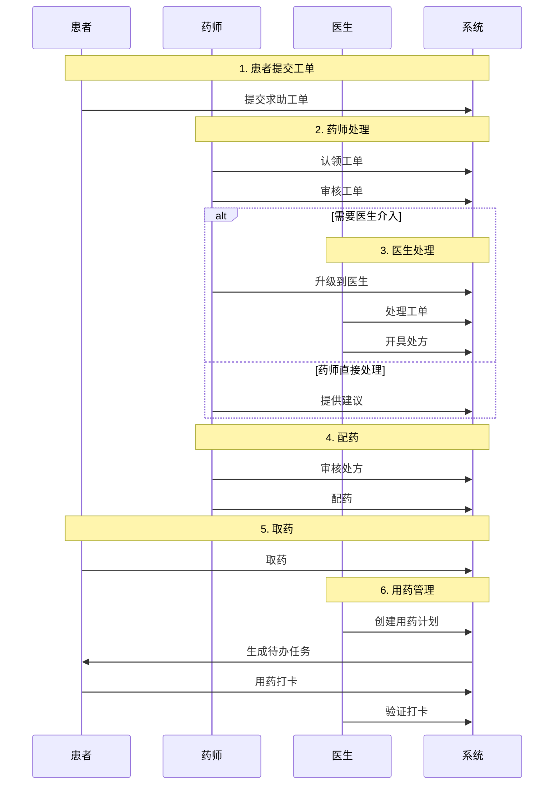
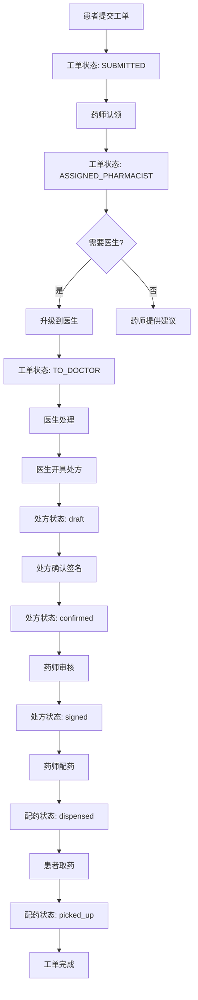
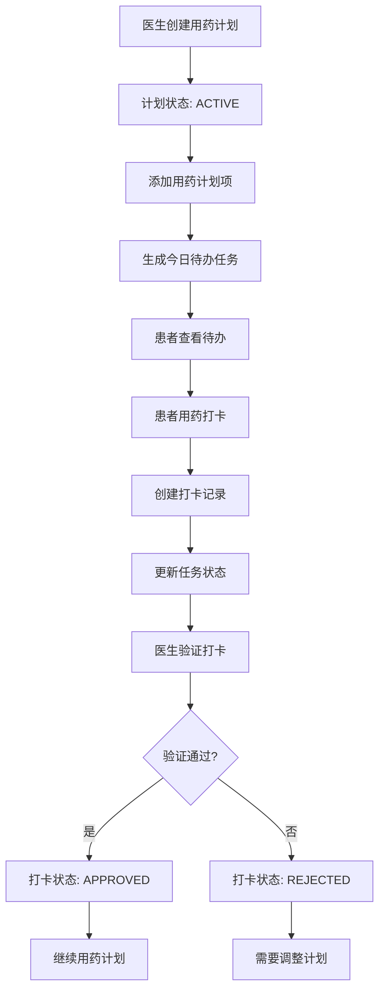

# 后端业务逻辑时序图总览

本文档包含了智能中医药房管理平台后端各个核心模块的时序图，展示了各业务流程的详细交互过程。

## 📋 时序图列表

### 1. 用户登录认证模块

**文档位置**：[时序图-用户登录认证.md](./时序图-用户登录认证.md)

**包含的时序图**：
- ✅ 用户登录流程
- ✅ 用户登出流程
- ✅ 刷新令牌流程
- ✅ 获取权限信息流程

**核心组件**：
- `AuthController` - 认证控制器
- `AdminAuthService` - 认证服务
- `AdminUserService` - 用户服务
- `OAuth2TokenService` - 令牌服务
- `LoginLogService` - 登录日志服务

### 2. 工单处理流程模块

**文档位置**：[时序图-工单处理流程.md](./时序图-工单处理流程.md)

**包含的时序图**：
- ✅ 患者提交工单流程
- ✅ 药师认领工单流程
- ✅ 升级到医生流程
- ✅ 医生处理工单流程
- ✅ 工单驳回流程
- ✅ 工单查询流程

**核心组件**：
- `HelpOrderController` - 工单控制器
- `HelpOrderService` - 工单服务
- `HelpOrderMapper` - 工单数据访问层
- `HelpOrderStatus` - 工单状态枚举

**工单状态流转**：
```
SUBMITTED → ASSIGNED_PHARMACIST → PHARMACIST_REVIEW → 
TO_DOCTOR → DOCTOR_REVIEW → PRESCRIPTION_READY → DONE
                ↓
            REJECTED
```

### 3. 处方管理流程模块

**文档位置**：[时序图-处方管理流程.md](./时序图-处方管理流程.md)

**包含的时序图**：
- ✅ 创建电子处方流程
- ✅ 医生确认并签名处方流程
- ✅ 药师审核处方流程
- ✅ 药师配药流程
- ✅ 患者查询处方流程
- ✅ 处方状态流转

**核心组件**：
- `ElectronicPrescriptionController` - 电子处方控制器
- `ElectronicPrescriptionService` - 电子处方服务
- `PrescriptionsController` - 处方控制器
- `PrescriptionsService` - 处方服务

**处方状态流转**：
```
draft → confirmed → signed → dispensed → picked_up → completed
```

### 4. 用药计划管理模块

**文档位置**：[时序图-用药计划管理.md](./时序图-用药计划管理.md)

**包含的时序图**：
- ✅ 创建用药计划流程
- ✅ 生成今日待办任务流程
- ✅ 患者查看今日待办流程
- ✅ 患者提交用药打卡流程
- ✅ 验证用药打卡流程
- ✅ 暂停/恢复用药计划流程
- ✅ 用药计划完整生命周期

**核心组件**：
- `MedPlanController` - 用药计划控制器
- `MedPlanService` - 用药计划服务
- `MedCheckinService` - 用药打卡服务
- `TodayTaskService` - 今日待办服务

**用药计划状态流转**：
```
ACTIVE → PAUSED → ACTIVE (恢复)
    ↓
TERMINATED
```

## 🔄 业务流程关联

### 完整业务链路



## 📊 数据流转图

### 工单到处方流转



### 用药计划到打卡流转



## 🎯 关键业务规则

### 1. 工单处理规则
- 工单必须按状态顺序流转，不能跳跃
- 只有特定状态才能进行特定操作
- 工单被驳回后不能继续处理
- 工单完成后不能修改

### 2. 处方管理规则
- 处方必须经过医生签名才能生效
- 药师必须审核处方才能配药
- 处方有有效期限制（默认7天）
- 处方状态和配药状态分别管理

### 3. 用药计划规则
- 用药计划必须包含至少一个计划项
- 今日待办任务基于计划项自动生成
- 患者打卡需要防重复提交
- 打卡记录需要医生/药师验证

### 4. 权限控制规则
- 不同角色有不同的操作权限
- 患者只能操作自己的数据
- 药师可以处理分配给自己的工单
- 医生可以处理升级给自己的工单

## 📝 使用说明

1. **查看具体时序图**：点击上方对应的文档链接，查看详细的时序图
2. **理解业务流程**：通过时序图了解各个模块的交互过程
3. **开发参考**：时序图可以作为开发时的参考，确保实现符合设计
4. **问题排查**：当出现问题时，可以通过时序图定位问题环节

## 🔗 相关文档

- [业务逻辑说明.md](./业务逻辑说明.md) - 详细的业务逻辑说明
- [API契约.md](../../01-快速开始/API契约.md) - API接口文档
- [技术实现方案.md](../../02-开发指南/技术实现方案.md) - 技术实现细节


